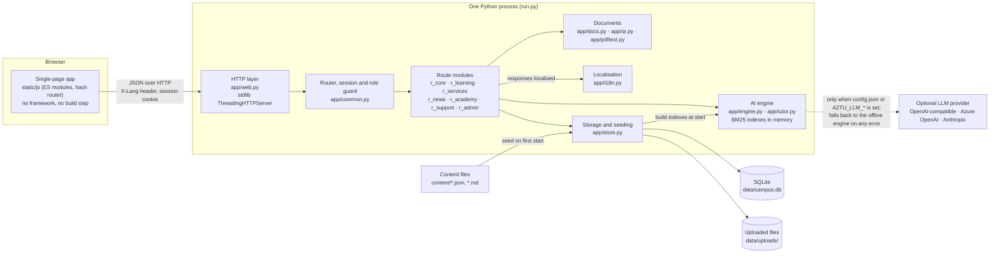

# Zəka: AzTU Digital Campus

Zəka is a web platform for Azerbaijan Technical University (AzTU) that brings an AI tutor, student e-services, assessment, campus news, a support desk and management reporting into one portal with one login and three interface languages. This repository holds demo version 0.3, developed by Safarov Industries.

The whole system is a single Python process that uses only the standard library. It needs no package installation, no build step and no database server. One command starts it on a laptop; the same code deploys to Render with the included blueprint.

- [The problem](#the-problem)
- [The solution](#the-solution)
- [Key features](#key-features)
- [Architecture](#architecture)
- [Tech stack](#tech-stack)
- [Quick start](#quick-start)
- [Guided demo](#guided-demo)
- [Status and limitations](#status-and-limitations)
- [Roadmap](#roadmap)
- [Repository layout](#repository-layout)
- [Documentation](#documentation)

## The problem

Student-facing processes at a university usually live in separate systems or on paper, and the people involved see only their own part:

- Students queue at the dean's office for certificates and transcripts, ask the same questions about attendance and grading rules, and have no way to see where a request stands.
- Teachers write test questions by hand and only learn which topics students struggle with when the exam results arrive.
- General-purpose AI chatbots give students finished answers with no connection to the course material and no control by the teacher, which creates an academic integrity problem rather than solving a learning one.
- Issued paper documents cannot be checked by the organisation that receives them.
- University leadership has no shared set of indicators across teaching, services and satisfaction.

## The solution

Zəka covers these processes in one application built around four rules that are enforced in the code, not just stated in a policy:

1. **Grounded AI.** The tutor answers only from material the teacher uploaded for that course, and every answer carries a numbered citation that opens the source passage. If nothing relevant is found, the tutor says so and offers to forward the question to the teacher.
2. **The teacher stays in control.** Teachers choose which tutor modes are allowed, add rules the AI must follow, lock the tutor during a test, and approve every generated question before it can appear in a test.
3. **Privacy by default.** E-mail addresses, phone numbers, card numbers and personal identification numbers are masked by default before a question reaches the AI engine or an external provider. Uploaded attachments such as medical certificates are visible only to the student, the dean's office and the administrator. Every file view, document issue and document revocation is written to an audit log.
4. **No dependency on an AI vendor.** An offline engine answers from the material with no external service. An OpenAI-compatible, Azure OpenAI or Anthropic model can be switched on with a configuration file, and the system falls back to the offline engine automatically when the provider is unreachable.

| Area | What version 0.3 does |
|---|---|
| AI tutor and campus assistant | Per-course tutor with Socratic, Explain and Practice modes; campus assistant that answers questions about university rules and links to the matching e-service |
| E-services | 13 request types in 6 categories, a dean's office workflow with deadlines and message threads, and issued documents that can be verified online by QR code |
| Assessment | Test Studio generates questions from course material; teachers review and publish practice or graded tests with per-question results |
| Campus life | Timetable, attendance, grades, news and events with registration, notifications, global search, support desk and feedback |
| Staff development | AI Academy with 7 tracks and 28 modules, certificates, a catalogue of 25 teaching tools, and a syllabus assistant |
| Management | Dashboards for the dean's office, leadership and the platform administrator, plus the audit log |

## Key features

### For students

- **AI tutor** for each course. Socratic mode gives one hint at a time and escalates over three steps instead of giving the solution; a request such as "just give me the answer" (in Azerbaijani, English or Russian) is recognised and declined. Explain mode summarises the topic with citations and ends with a self-check question. Practice mode asks approved questions and grades typed answers.
- **Campus assistant** that answers questions about certificates, attendance, grading, scholarships, dormitories and similar rules from a knowledge base. A question asked in English or Russian is matched to the Azerbaijani rule text, and the answer includes a button that opens the relevant request form.
- **E-services**: order an enrolment certificate or transcript, excuse an absence with a medical certificate, request leave for a competition, reschedule an exam, apply for academic leave, appeal a grade, request an individual study plan, instalment payments, a social scholarship, a dormitory place, a replacement student card, or file a free-form application. Each request has a form with validation, attachments, a status timeline, a message thread with the dean's office, and resubmission after a return.
- **Attendance and grades**: attendance per course against the 25% absence limit, with a shortcut from the absences to the excuse request with the dates filled in; current semester components and past-semester transcripts.
- **Tests** with time limits, attempt limits, explanations and a source citation for every question.
- **News and events** with registration (capacity-aware), bookmarks and calendar export in iCalendar format.
- **Notifications**, global search across services, news, courses, materials and guides, guided tours on every page, support tickets and a feedback button on every page.

### For teachers

- **Material upload** in Markdown, plain text, Word (.docx) or PowerPoint (.pptx). The text is split into sections by heading, indexed immediately and available to the tutor without a restart.
- **Tutor settings per course**: allowed modes, free-text rules the AI must follow (for example, "always use SI units"), and a lock switch for exam periods.
- **Student questions** forwarded from the tutor, optionally anonymous, answered from one screen; the student receives the answer as a notification.
- **Test Studio**: generates multiple-choice, true/false and numeric questions from the material, flags near-duplicates of existing questions, keeps them as drafts until approved, and publishes tests. Results show the score distribution and the correct-answer rate per question.
- **Course insights**: tutor questions per week, most asked topics, share of positively rated answers, share of answers with a citation, and the questions the material could not answer, which point to content gaps.
- **AI Academy**: 7 professional development tracks (AI in education, teaching in English, syllabus design, academic communication, teaching methods, research and grants, subject-specific tools) with 28 modules, quizzes, a self-assessment that recommends tracks, and a certificate when a track is completed.
- **Tool catalogue** of 25 teaching tools by subject area, attachable to a course.
- **Syllabus assistant** that drafts learning outcomes, a 15-week plan, workload, assessment scheme and policies from the uploaded material, then lets the teacher edit, save and print the result.

### For the dean's office

- **Request queue** sorted by status and deadline, with overdue marking, filters by category and type, and search. Actions: approve to the next step, return for correction with a note, reject with a reason, issue.
- **Document issue**: each document receives a registry number, an 8-character verification code, a SHA-256 hash of its content and a QR code, and is rendered in Azerbaijani or English. A preview is available before issue. Documents can be revoked with a reason, and the registry can be searched.
- **Side effects on approval**: an approved absence excuse marks the selected lessons as excused and notifies the affected teachers; approved leave and exam rescheduling notify the teachers concerned.
- **News editor**, **support desk** with priorities, service-level targets, internal notes and assignment, and a **satisfaction dashboard** with ratings, NPS, trends by week and by area.

### For leadership and the administrator

- **Leadership dashboard**: tutor usage per course, request processing times, attendance, test averages, citation rate, academy completion, feedback and NPS, with generated recommendations (for example, which course needs more material because questions go unanswered).
- **Administrator panel**: engine status, LLM connection test, platform limits (daily messages per student, PII masking), record counts, the audit log, and a data reset.

### Platform

- **Three languages** (Azerbaijani, English, Russian) for the interface, server messages, notifications, forms and tutor phrasing. Course material and quoted sources stay in their original language.
- **Public pages**: online document verification, 18 AzTU achievements each linked to an official source, and official contact details.
- **Accessible, responsive interface**: light and dark themes, collapsible sidebar, mobile layout with bottom navigation, keyboard shortcuts, and respect for the reduced-motion preference.

## Architecture



A request passes through the HTTP layer (security headers, static files, JSON body checks), the router (pattern match, session lookup, role check), one handler function in a route module, and the localiser that translates the JSON response into the language the client asked for. Each request opens its own SQLite connection and commits on success or rolls back on error. The AI engine keeps three BM25 indexes in memory (course material, campus knowledge base, question bank), rebuilt from the database at start and updated in place when a teacher uploads material or approves a question.

The full description, including the data model, the document and verification flow, the search engine and the localisation pipeline, is in [docs/ARCHITECTURE.md](docs/ARCHITECTURE.md). The HTTP API is documented in [docs/API.md](docs/API.md).

## Tech stack

| Layer | Choice | Notes |
|---|---|---|
| Language | Python 3.10 or newer, standard library only | Test suite passes on Python 3.11 and 3.13; the Render blueprint pins 3.12.6 |
| HTTP server | `http.server.ThreadingHTTPServer` with a small router | HTTP/1.1, one thread per request, security headers on every response |
| Storage | SQLite in WAL mode | 40 tables, schema version check with automatic reseed, uploads stored by content hash |
| Search and AI | In-memory BM25 with Azerbaijani-aware tokenisation and stemming | Three indexes; rule-based answer composition and question generation |
| LLM integration | `urllib` client for OpenAI-compatible, Azure OpenAI and Anthropic APIs | Optional; automatic fallback to the offline engine |
| Documents | Server-rendered HTML with a pure-Python QR encoder and PDF text extractor | Printable from the browser; verification page is public |
| Frontend | Vanilla JavaScript ES modules and CSS | No framework, no bundler, no runtime dependency; Inter font served locally |
| Localisation | gettext-style catalogues, Azerbaijani source text as the key | Server and client catalogues generated by `tools/i18n.py` |
| Tests | `tests/selftest.py` | Unit checks plus an end-to-end HTTP test against a live server: 136 checks |
| Deployment | `run.py` command line, Windows scripts, Render blueprint | Configurable host, port and public URL |

Approximate size of the code base:

| Part | Lines |
|---|---|
| Backend (`app/`, `run.py`) | 5,600 |
| Frontend JavaScript (`static/js/`) | 4,550 |
| Stylesheets (`static/css/`) | 1,300 |
| Test suite and tooling (`tests/`, `tools/`) | 900 |

## Quick start

Requirements: Python 3.10 or newer and a current browser. Nothing is installed with pip.

```bash
git clone https://github.com/MrHerc/AzTU-Zeka.git
cd AzTU-Zeka
python run.py
```

Open http://127.0.0.1:5070 and choose a demo role. The first start creates `data/campus.db` and fills it with demo data; later starts reuse it. On Windows, `start_demo.bat` starts the server and opens the browser; `scripts\start_demo.ps1` and `scripts\stop_demo.ps1` run it in the background.

### Command-line options

| Option | Environment variable | Default | Purpose |
|---|---|---|---|
| `--port` | `PORT` | `5070` | Listening port |
| `--host` | `HOST` | `127.0.0.1` | Listening address; use `0.0.0.0` on a server |
| `--public-url` | `PUBLIC_URL` | none | Public address of the portal. QR codes on documents point here, and the session cookie gets the `Secure` flag when the scheme is `https` |
| `--reset` | | | Recreate the demo database from scratch |

The database is also recreated automatically when the schema version in the code changes.

### Demo roles

Demo login is by role and has no password. The server is meant to listen only on this computer in demo mode; on a server, put it behind a reverse proxy that terminates HTTPS and restricts access.

| Role | Demo user | Home page |
|---|---|---|
| Student | Aysel Məmmədova, group İT-25-1 | `#/student` |
| Teacher | Assoc. Prof. Rauf Əliyev, Electronics | `#/teacher` |
| Dean's office | Nigar Rzayeva | `#/office` |
| Leadership | Rector's office | `#/leader` |
| Administrator | IT centre | `#/admin` |

You can switch roles from the profile menu. A role can also be opened directly with `GET /demo/login?role=teacher`.

### Connecting an LLM

By default the offline engine answers from the material. To use a hosted model, copy `config.example.json` to `config.json` and fill in the provider, base URL, API key and model, or set the environment variables `AZTU_LLM_PROVIDER`, `AZTU_LLM_BASE_URL`, `AZTU_LLM_API_KEY` and `AZTU_LLM_MODEL`. Supported providers:

| `provider` | Endpoint used | Notes |
|---|---|---|
| `openai` | `<base_url>/chat/completions` | Any OpenAI-compatible API |
| `azure` | `<base_url>/openai/deployments/<model>/chat/completions` | `model` is the deployment name |
| `anthropic` | `<base_url>/v1/messages` | `model` is a Claude model id |

The administrator panel has a connection test. When the provider fails, the tutor answers with the offline engine and records the reason in the message metadata. `config.json` is ignored by git.

### Running the tests

```bash
python tests/selftest.py
```

The suite resets the demo database, checks the QR encoder, stemming, PII masking and question generation, then starts a server on a random port and exercises the API for every role. Restart the server afterwards because the database has been reset.

### Deploying to Render

`render.yaml` is a Render blueprint: a free web service in the Frankfurt region, Python 3.12.6, started with `python run.py --host 0.0.0.0 --port $PORT`, with `PUBLIC_URL` filled in from the service host. The free plan has no persistent disk, so the database and uploaded files are recreated on every restart. Use a plan with a disk mounted at `data/` for anything beyond a demo.

## Guided demo

A walk-through that shows the main flows in about 12 minutes:

1. **Student**: accept the consent dialog, follow the welcome tour, ask the AI tutor a question in Socratic mode, click a citation to open the source, switch the interface to English or Russian.
2. **Student**: order an enrolment certificate in E-services; open Attendance and excuse an absence with a medical certificate.
3. **Dean's office**: approve the request, preview the document inside the portal, issue it; answer a support ticket and change its status.
4. **Teacher**: upload a material, generate questions in Test Studio, approve them, publish a test; complete an AI Academy module to receive a certificate.
5. **Leadership**: review the pilot indicators, the feedback dashboard and the satisfaction panel. Any role: open Achievements and Contact.

## Status and limitations

This is a demonstration build, not a production system.

- Login is by demo role without a password. Single sign-on with the university account is listed as planned in the code but not implemented.
- All people, courses, grades, requests, tickets and feedback are synthetic and regenerated with a fixed random seed. The achievements and contact details are real and sourced from the university's official site.
- Issued documents carry a DEMO watermark and have no legal validity.
- Some values on the leadership dashboard are fixed illustrative numbers rather than computed from data: weekly active students and teachers, the test preparation time reduction, the satisfaction score and trend, the learning gain, the cost per student, and the earlier weeks of the request time, citation and academy series. Computed from data are the tutor question counts, the current citation rate, academy completion and request processing time, attendance, test averages, and the feedback scores and NPS on the feedback dashboard.
- Sessions do not expire. The administrator settings for data retention and the default tutor mode are stored but not enforced in this version.
- The server is a single process with SQLite and in-memory indexes; it is sized for a department pilot, not for a whole university.
- Consent cannot be withdrawn in the demo; the profile page explains what the pilot behaviour will be.
- The repository has no licence file. Contact Safarov Industries for terms of use.

## Roadmap

The items below are the ones the current code explicitly marks as planned for the pilot phase, followed by gaps that are visible in the code. No dates are committed.

Marked as planned in the code:

1. **Single sign-on** with the university account (login page and system status).
2. **Integration with the LMS and the student registry** (system status page).
3. **Electronic signature** of issued documents with ASAN İmza or SİMA (document footer).
4. **Consent withdrawal** that disables AI functions and creates a deletion request for the chat history (profile page).

Open gaps:

5. Persistent storage for hosted deployments; the Render free plan resets the database on restart.
6. Session expiry and enforcement of the retention setting.
7. Replacing the illustrative dashboard series with computed values once real usage exists.

## Repository layout

```
run.py                 Entry point: parses options, seeds the database, starts the server
app/
  web.py               HTTP layer: request parsing, router, static files, security headers, error mapping
  common.py            Shared helpers: session guard, one-time document links, usage limits, citations
  routes.py            Registers the route modules (import order defines matching order)
  r_core.py            Login, profile, preferences, notifications, search, guides, file upload and preview
  r_learning.py        Courses, materials, tutor, campus assistant, schedule, attendance, grades, tests, Test Studio
  r_services.py        E-services: catalogue, requests, dean's office actions, documents, verification page
  r_news.py            News, events, registration, bookmarks, iCalendar export, editor
  r_academy.py         AI Academy, tool catalogue, syllabus assistant
  r_support.py         Support desk, feedback, system status, achievements, contacts
  r_admin.py           Leadership analytics and administrator settings
  engine.py            Tokenisation, BM25 index, chunking, text extraction, PII masking, LLM client, question generation
  tutor.py             Answer composition: Socratic, Explain, Practice, campus assistant
  store.py             SQLite schema, helpers, file storage, document issue, demo data seeding
  docs.py              Printable documents and the verification page
  qr.py                QR code encoder (SVG output)
  pdftext.py           PDF text extraction for in-app previews
  i18n.py              Server-side localisation
  refs.py              Verified external references for courses, materials and academy modules
  support.py           Support desk vocabularies and synthetic tickets
  locales/             Generated server catalogues (en.json, ru.json)
static/
  index.html           Application shell
  js/                  ES modules: core, shell, router pages per area, tours, chat, i18n
  css/                 Stylesheets per area, print styles for documents
  locales/             Generated client catalogues
  fonts/, img/         Inter font subsets, brand images
content/
  seed.json            University, faculty, users, courses, timetable, service catalogue, question bank, tests
  materials/*.md       Course materials indexed for the tutor
  campus_kb.md         Campus knowledge base for the assistant
  academy.json         AI Academy tracks and modules
  tools.json           Teaching tool catalogue
  news.json            Demo news and events
  guide.json           Help articles, FAQ, shortcuts
  achievements.json    Real AzTU achievements with sources
  references.json      Verified external references
  contacts.json        Official contact details
i18n/                  Translation sources (en/, ru/), extraction output, translation brief
tools/i18n.py          Lint, extract, build and report translation coverage
tests/selftest.py      Backend and API test suite
scripts/               Windows start and stop scripts
render.yaml            Render blueprint
config.example.json    LLM configuration template
```

Runtime directories `data/` (database and uploads) and `logs/` are created on first start and are not committed.

## Documentation

- [docs/ARCHITECTURE.md](docs/ARCHITECTURE.md): system design, request lifecycle, data model, AI engine, documents, localisation, deployment and testing.
- [docs/API.md](docs/API.md): the HTTP API, conventions and every endpoint with its role requirements.
- [i18n/BRIEF.md](i18n/BRIEF.md): translation rules and glossary for the three interface languages.

Translation workflow:

```bash
python tools/i18n.py lint      # find interface text that is not wrapped for translation
python tools/i18n.py extract   # write i18n/source/*.json and the untranslated remainder to i18n/todo/
python tools/i18n.py build     # merge i18n/en and i18n/ru into the server and client catalogues
python tools/i18n.py stats     # coverage per language
```

Developed by Safarov Industries.
