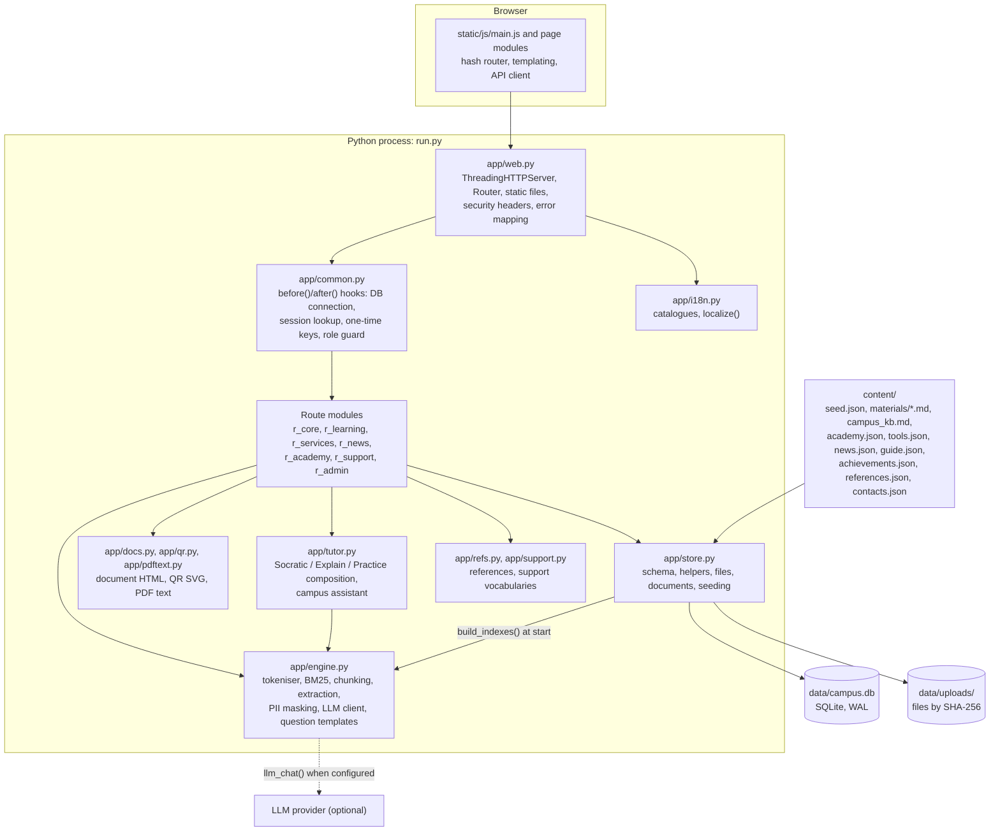
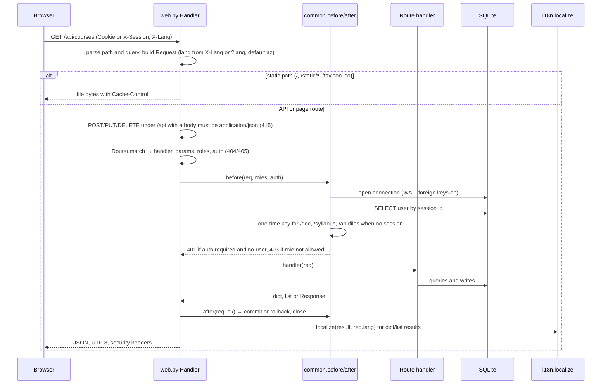
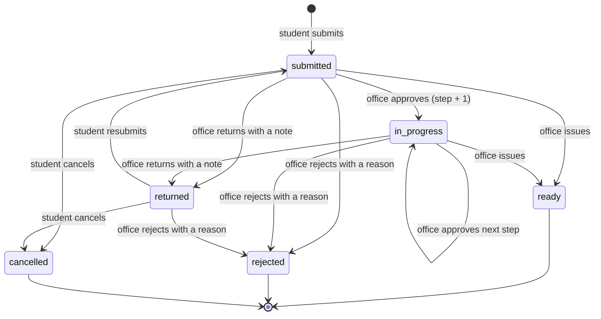
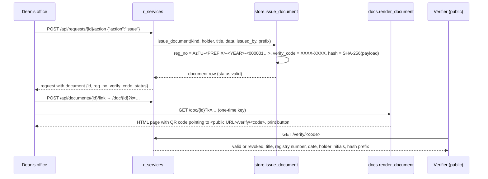

# Architecture

This document describes how Zəka (AzTU Digital Campus, demo version 0.3) is built. Everything here is taken from the code in this repository; where the code marks something as planned or illustrative, the document says so.

- [1. Overview](#1-overview)
- [2. Process model and request lifecycle](#2-process-model-and-request-lifecycle)
- [3. Authentication and authorisation](#3-authentication-and-authorisation)
- [4. Data model](#4-data-model)
- [5. Demo data seeding](#5-demo-data-seeding)
- [6. File storage](#6-file-storage)
- [7. E-services workflow](#7-e-services-workflow)
- [8. Documents, QR codes and verification](#8-documents-qr-codes-and-verification)
- [9. AI engine](#9-ai-engine)
- [10. Tutor and campus assistant](#10-tutor-and-campus-assistant)
- [11. Question generation and grading](#11-question-generation-and-grading)
- [12. Localisation](#12-localisation)
- [13. Frontend](#13-frontend)
- [14. Notifications, badges and audit](#14-notifications-badges-and-audit)
- [15. Analytics](#15-analytics)
- [16. Logging and status](#16-logging-and-status)
- [17. Deployment](#17-deployment)
- [18. Testing](#18-testing)
- [19. Known limitations and technical debt](#19-known-limitations-and-technical-debt)

## 1. Overview

Zəka is a single Python process that serves a single-page web application and a JSON API from the same origin. It depends only on the Python standard library and on a current browser. There is no build step for the frontend and no external service is required at runtime; an LLM provider is optional.

### Module map

| File | Lines | Responsibility |
|---|---|---|
| `run.py` | 57 | Command-line options, database initialisation, server start, error log |
| `app/web.py` | 195 | `Request`, `Response`, `Router`, `HTTPError`, `make_server()`; static files; security headers |
| `app/common.py` | 183 | `R` router instance, `before()`/`after()`, session cookie, one-time keys, course access, usage limits, citation helpers |
| `app/routes.py`, `app/api.py` | 5 | Import the route modules in matching order; compatibility shim for `run.py` and tests |
| `app/r_core.py` | 289 | Login, logout, consent, profile, preferences, badges, notifications, guide, search, file upload, download, preview |
| `app/r_learning.py` | 744 | Courses, materials, sources, schedule, attendance, grades, student and teacher home, tutor, campus assistant, tests, Test Studio |
| `app/r_services.py` | 492 | Service catalogue, request validation and lifecycle, dean's office actions, office summary, documents, verification page |
| `app/r_news.py` | 200 | News feed, detail, registration, bookmarks, iCalendar export, editor |
| `app/r_academy.py` | 284 | AI Academy, self-assessment, module completion and certificates, tool catalogue, syllabus assistant |
| `app/r_support.py` | 309 | Support tickets, feedback, system status, achievements, contacts |
| `app/r_admin.py` | 137 | Leadership analytics, administrator status, settings, LLM test, audit log, reset |
| `app/engine.py` | 682 | Text utilities, BM25, chunking, glossary, text extraction, PII masking, LLM client, answer helpers, grading, question generation |
| `app/tutor.py` | 191 | `compose_tutor()`, `compose_campus()`, `llm_tutor()`, practice formatting, cross-language query expansion |
| `app/store.py` | 761 | Schema, connection, row helpers, settings, notifications, file storage, materials, index building, document issue, transcripts, seeding, `init()`, `reseed()` |
| `app/docs.py` | 201 | Printable documents (enrolment certificate, transcript, academic leave extract, academy certificate) and the verification page |
| `app/qr.py` | 277 | QR encoder: byte mode, error correction level M, versions 1 to 10, SVG output |
| `app/pdftext.py` | 235 | PDF text extraction: FlateDecode, object streams, ToUnicode CMaps, simple and Type0 fonts |
| `app/i18n.py` | 199 | Catalogue loading, `S`/`T3`/`E`/`S_`, plural rules, `localize()`, `canon()` |
| `app/refs.py` | 57 | Verified external references from `content/references.json`, https-only |
| `app/support.py` | 119 | Support categories, priorities, statuses, SLA hours, feedback areas, synthetic tickets and feedback |

## 2. Process model and request lifecycle

`run.py` parses the options, calls `store.init()` (which creates or reseeds the database and builds the search indexes), sets the public base URL used for QR codes and cookies, and starts a `ThreadingHTTPServer` with daemon threads. Each request runs in its own thread. Access logging is disabled; unhandled exceptions are written to `logs/errors.log` with a traceback.

Error mapping: an `HTTPError(status, message)` raised anywhere becomes `{"error": "<translated message>"}` for paths under `/api/` and a small HTML page otherwise. Any other exception is logged and returned as a generic 500 message. Route parameters written as `{id:int}` match digits only and arrive as integers; `{code}` matches any path segment.

Security headers on every response: `X-Content-Type-Options: nosniff`, `Referrer-Policy: same-origin`, and a Content Security Policy that allows scripts and connections from the same origin only, images from the same origin and `data:` URLs, and inline styles. Static files are served from `static/` with a path check that rejects anything outside the directory; fonts and PNG images are cacheable for a day, other static files are `no-cache`. The maximum request body is 30 MB.

## 3. Authentication and authorisation

**Demo login.** `POST /api/auth/demo {"role": ...}` looks up the demo username for that role in the `demo_logins` setting, creates a row in `sessions` with a random 24-byte id, writes an audit entry and returns the user, the role home path and the session id. `GET /demo/login?role=...&next=...` does the same and redirects; `next` must be a same-origin path.

**Session transport.** The session id is set as the cookie `zeka_sid` (`HttpOnly; SameSite=Lax; Path=/`, plus `Secure` when the public URL starts with `https://`). The client also keeps the id in `sessionStorage` and sends it as the `X-Session` header, so the application works where cookies are blocked. Logout deletes the session row and expires the cookie. Sessions have no expiry in this version.

**Roles.** `student`, `teacher`, `office` (dean's office and registrar), `leader` (rector's office) and `admin`. Each route declares `roles` and `auth`; `before()` returns 401 when a login is required and missing, and 403 when the role is not in the list. Apart from the two login routes, four routes are public: `/api/bootstrap`, `/api/achievements`, `/api/contact` and the verification page `/verify/{code}`.

**Object-level rules** are enforced in the handlers:

| Object | Rule |
|---|---|
| Course | Students must be enrolled; teachers must own the course; office, leader and admin may read any course (`course_access`) |
| Request | Students see their own; office, leader and admin see all; teachers see none |
| Uploaded file | Owner, office and admin only; every download and preview is audited |
| Document | Holder, office, leader and admin |
| Support ticket | Owner; office and admin work the queue; leader may read; internal notes are hidden from the owner |
| News | Audience filter (`all`, `students`, `teachers`); drafts visible to staff only |

**One-time keys.** Documents, syllabi and files open in a new tab, where a `sessionStorage` token is not available. `POST /api/documents/{id}/link` (and the equivalents for syllabi and files) returns a URL with `?k=<key>`. Keys are random, kept in process memory, valid for five minutes, single-use, and bound to the object kind and id. `before()` resolves the key to its user when the request carries no session.

## 4. Data model

SQLite at `data/campus.db`, WAL journal, foreign keys on, one connection per request with a 15-second busy timeout. Structured values (options, JSON schemas, metadata) are stored as JSON text; strings that must appear in three languages are stored as JSON objects `{"az","en","ru"}` and resolved by the localiser on output. The schema has 40 tables.

| Domain | Tables | Notes |
|---|---|---|
| Identity and settings | `settings`, `study_groups`, `users`, `sessions` | `settings` holds JSON values (university, faculty, specialty, demo logins, limits, semester start, vocabularies). `users.prefs` holds theme, language, sidebar state, completed tours and the academy self-assessment. `users.synthetic` marks generated people |
| Teaching | `courses`, `enrollments`, `timetable`, `lessons`, `attendance`, `grades` | `timetable` is the weekly pattern; `lessons` are dated instances generated from it since the semester start; `attendance` rows are per lesson and student with status `present`, `late`, `absent` or `excused` and the excusing request id; `courses` carries the tutor settings (`tutor_modes`, `tutor_rules`, `tutor_locked`) |
| Material and knowledge | `materials`, `chunks`, `campus_kb` | A material keeps the full text; `chunks` are its sections, which are the unit of retrieval and citation; `campus_kb` entries come from `content/campus_kb.md` and may point to a request type |
| Conversations | `messages`, `teacher_questions` | `messages.channel` is `tutor` (per course) or `campus`; `cites` is a list of chunk or knowledge base ids; `meta` holds mode, topic, Socratic level, practice state, PII labels and engine notes; `rating` is 1, -1 or null |
| Assessment | `questions`, `quizzes`, `attempts` | Question types `mcq`, `tf`, `numeric`; status `draft` or `approved`; origin `manual` or `ai`; `flags` such as `source_ok` and `similar`. A quiz stores an ordered list of question ids, a time limit in minutes, an attempt limit and a kind (`practice` or `graded`). An attempt stores the answers, per-question details and the score |
| E-services | `service_categories`, `request_types`, `requests`, `request_events`, `request_messages` | `request_types` is the catalogue, including the form schema (`fields`), workflow `steps`, `sla_hours`, the document title and registry `prefix`, and the attachment rule. `requests` hold the validated data, status, current step, deadline and the issued document id. Events form the timeline; messages form the thread |
| Files and documents | `files`, `documents` | See sections 6 and 8 |
| Communication | `notifications`, `news`, `news_rsvp`, `news_saved`, `news_reads` | Notifications are per user with a kind, a link and a read timestamp |
| Academy | `academy_tracks`, `academy_modules`, `academy_progress`, `tools`, `course_tools`, `syllabi` | Modules carry paragraphs, key points, phrases, a task and a quiz; progress is per user and module; a saved syllabus is one JSON document per course |
| Support | `support_tickets`, `support_messages`, `feedback` | Tickets carry category, priority, status, assignee and rating; messages may be internal; feedback rows carry a score, an optional NPS value and an area |
| Audit | `audit` | Timestamp, user, action, entity, detail |

**Schema versioning.** `SCHEMA_VERSION` (currently 3) is written to `PRAGMA user_version` after seeding. On start, a database with a different version, a corrupt file, or the `--reset` flag causes the database and its WAL files to be deleted and recreated. `POST /api/admin/reset` deletes all rows and reseeds without restarting the process.

## 5. Demo data seeding

`store.seed()` runs when the `users` table is empty. It reads `content/seed.json` and the other content files and generates everything else with `random.Random(42)`, so each fresh database is identical except for timestamps, which are relative to the current date.

- University, faculty, programme, demo logins and past semesters come from the seed file. Limits default to 50 assistant messages per student per day, PII masking on, 180 days retention, Socratic mode on.
- The semester start is 15 September or 15 February, whichever is the most recent, moved back to three weeks ago if that date is less than two weeks old.
- 6 courses with 16 material files, weekly timetables, lessons for every slot since the semester start, and enrolments for 120 students (one named demo student and 119 generated ones). The demo student is absent on the last Monday and Tuesday before today, which gives the attendance and excuse scenario its six absences.
- 6 named teachers and 18 generated ones; seeded grades for two assessment components per course.
- 17 knowledge base entries parsed from the Markdown headings in `campus_kb.md`, with the request code, button label and source taken from an HTML comment under each heading.
- 43 approved questions and 10 tests, with 85 generated attempts per practice test and fixed result patterns for the demo student.
- Roughly 1,800 synthetic tutor exchanges across the courses (per-course weights), with topics, citations and ratings, used by the course insights and the leadership dashboard.
- E-service requests in every status, including one ready enrolment certificate for the demo student, one revoked document and generated one-page PDFs as medical certificate attachments.
- Academy progress for the demo teacher, news with registrations and read marks, notifications per role, support tickets and 140 feedback entries.

Generated timestamps for office activity are folded into 09:00 to 17:59 so that requests are not shown as filed at night.

## 6. File storage

`store.save_file()` validates and stores an upload:

| Check | Rule |
|---|---|
| Size | Non-empty and at most 10 MB |
| Type | Detected from magic bytes (PDF, PNG, JPEG, ZIP container for DOCX); the file extension, when present, must agree with the detected type |
| Image-only fields | PNG or JPEG only when the field asks for a photo |
| Name | Characters outside letters, digits, Azerbaijani letters, space, dot, parentheses and hyphen are replaced; truncated to 120 characters |

The content is written to `data/uploads/<sha256>.bin` once per distinct content, and a `files` row records the owner, original name, MIME type, size and hash. A file is attached to a request when the request is created or resubmitted; a file can be attached only once. Downloads are served with `Content-Disposition` (inline or attachment) and `Cache-Control: private, no-store`. `GET /api/files/{id}/preview` returns extracted text per page for PDF (via `pdftext`), the paragraphs of a DOCX, or the kind `image` so the client can render it.

Course materials are different: `POST /api/courses/{id}/materials` extracts text from `.md`, `.txt`, `.docx` or `.pptx` (`engine.extract_text`), prefixes a title heading if missing, and stores the text in `materials` and its sections in `chunks`. The index is updated in place, so the tutor can use the material immediately.

## 7. E-services workflow

The catalogue (`request_types`) defines each service declaratively. A form field has `name`, `label`, `type` and optionally `required`, `options`, `show_if` (a map of other field values that make this field visible), `min`/`max` for numbers, `future` for date ranges, and the display texts `placeholder`, `hint` and `hint_if`. Field types: `text`, `textarea`, `number`, `date`, `daterange`, `radio`, `select`, `course`, `courses`, `absences`. The attachment rule has `label`, `required`, `max` and `accept` (`doc` or `image`). The `steps` list names the workflow stages shown on the timeline.

`validate()` enforces the schema on the server: options are canonicalised back to the Azerbaijani value when a translated label is submitted, hidden fields are blanked, numbers are range-checked, date ranges must be ordered and at most 60 days long, must start in the future when the field sets `future` (leave permission) and must not end in the future otherwise (absence excuse); course fields must refer to the student's enrolments; selected absences must be unexcused lessons of the student inside the chosen period.

Each transition writes a `request_events` row. Submission, resubmission and student messages notify the dean's office; office actions and office messages notify the student; cancellation sends no notification. The deadline is `created_at + sla_hours`; an open request past its deadline is flagged `overdue` (returned requests are not). Issuing a request whose type defines a document calls `issue_document()`; otherwise the office note or the type's standard answer is stored. Issue also applies the outcome: an approved absence excuse sets the selected attendance rows to `excused` and notifies the teachers of those lessons; approved leave and exam rescheduling notify the teachers concerned.

The office queue orders requests by status (`submitted`, then `in_progress`, then the rest) and deadline, and supports filtering by status group, type and category and searching by student name, id or type.

## 8. Documents, QR codes and verification

- **Registry number**: `AzTU-<prefix>-<year>-<sequence>`, where the prefix comes from the request type (`ARY`, `TRN`, `AKM`, …, `SRT` for academy certificates) and the sequence counts documents of that prefix and year.
- **Verification code**: eight characters from an alphabet without `0`, `O`, `1` and `I`, shown as two groups of four; uniqueness is checked against the table.
- **Hash**: SHA-256 of a canonical JSON payload of registry number, title, holder id and document data; the first characters are printed on the document and the verification page.
- **Status**: `valid`, or `revoked` with a reason and timestamp. A revoked document still renders but with a warning; the verification page shows it as revoked.
- **Rendering**: enrolment certificates and transcripts render in Azerbaijani or English depending on the requested language, with passport-style transliteration of names (`engine.translit`). Transcript grades for past semesters are deterministic synthetic values derived from the user id. Academic leave renders an extract from a rector's order. Academy certificates use a separate layout. Every document carries a DEMO watermark and a footer that states it is not legally valid.
- **QR code**: `app/qr.py` implements byte-mode encoding with Reed-Solomon error correction at level M for versions 1 to 10, enough for verification URLs up to 213 bytes, and renders an SVG. The test suite checks the encoder against a published Reed-Solomon vector and the format and version bit strings from the QR standard.
- **Verification page**: public, minimal data (holder shown as initials only), served in the requested language.

## 9. AI engine

### Text processing

Azerbaijani text has the dotted and dotless i distinction, so lowercasing maps `I` to `ı` and `İ` to `i` before the standard lowercase. Folding maps `ə ı ö ü ş ç ğ` to ASCII letters for matching. Tokens are runs of Latin, Azerbaijani or Cyrillic letters and digits. The stemmer strips a small set of case suffixes and the plural suffix from words of six or more characters and truncates stems to five characters. A stop list covers Azerbaijani function words and a few English ones.

### BM25 index

`engine.BM25` is an in-memory inverted index with `k1 = 1.5` and `b = 0.75`. Each document stores its term frequencies, length and metadata; headings are added twice to the term counts as a boost. `search(query, k, where)` scores every document that passes the `where` filter, so a course-scoped tutor search only considers chunks of that course. Adds and removals update document frequencies under a lock.

Three indexes live in `engine.INDEX`:

| Index | Documents | Used by |
|---|---|---|
| `chunks` | Material sections, metadata: course, material, heading, text | Tutor, global search |
| `campus` | Knowledge base entries, metadata: heading, text, request code, action label, source | Campus assistant |
| `questions` | Approved and draft questions, metadata: course, status | Practice mode question selection |

`store.build_indexes()` rebuilds all three from the database at start; `add_material`, `delete_material`, `index_question` and the question delete handler update them in place.

### Chunking and glossary

`chunk_markdown()` takes the first `# ` line as the title and splits the rest at `## ` headings; a section longer than 1,100 characters is split at paragraph boundaries into numbered parts. `glossary()` extracts `**Term** — definition` lines (and capitalised `Term — definition` lines) and is the basis for question generation, syllabus outcomes and the tutor's concept prompts. Formulas are lines starting with `>`; code examples are fenced blocks.

### Text extraction

`extract_text()` reads `.md` and `.txt` (UTF-8 with BOM, then cp1254, then Latin-1), `.docx` (paragraphs from `word/document.xml`; `Heading` and `Title` styles become Markdown headings) and `.pptx` (one `## Slayd n` section per slide). Both Office formats are read with `zipfile` and `xml.etree`.

### PII masking

Before a question reaches the retrieval or an LLM, `mask_pii()` replaces e-mail addresses, Azerbaijani phone numbers, card-like digit sequences of 16 to 19 digits and 7-character FİN identifiers with labelled placeholders. The labels found are stored in the message metadata. The administrator can turn masking off for the tutor (`limits.pii_masking`); the campus assistant always masks. The stored copy of the user's message keeps the original text, so masking protects what the engine and any external provider receive, not the local database.

### LLM client

`llm_config()` merges `config.json` (key `llm`) with the environment variables `AZTU_LLM_PROVIDER`, `AZTU_LLM_BASE_URL`, `AZTU_LLM_API_KEY` and `AZTU_LLM_MODEL`; environment values win. The provider is enabled only when both an API key and a model are set. `llm_chat(system, messages, max_tokens)` posts with `urllib` to the OpenAI chat completions endpoint, the Azure OpenAI deployment endpoint (`api-version` configurable, default `2024-10-21`) or the Anthropic Messages API, with a configurable timeout (default 40 seconds) and temperature 0.3 where supported. Any exception propagates to the caller, which falls back to the offline engine.

## 10. Tutor and campus assistant

### Tutor request flow (`POST /api/tutor/{cid}/ask`)

1. The course is loaded with access checks; a locked tutor returns 423 to students.
2. The mode is taken from the body if the course allows it, otherwise the first allowed mode.
3. The daily limit is checked for students (default 50 user messages per day across all channels; 429 when reached).
4. The message is PII-masked if enabled and the last 12 messages of this user and course are loaded as history.
5. Practice mode goes to `practice_turn()`. Other modes retrieve the top 4 chunks of the course.
6. If an LLM is enabled and the best chunk scores at least 1.2, `llm_tutor()` builds a system prompt with the course name, the teacher's rules, the answer language and the top sources (up to 1,500 characters each), sends the last 6 messages, and renumbers the model's `[n]` citations to the sources actually used. On any error the offline engine answers and the error type is recorded in the message metadata as a note.
7. Otherwise `compose_tutor()` answers offline.
8. The original user message and the answer are stored; the response carries the answer, its citations and the usage counter.

### Offline composition

- Greetings and thanks get fixed replies. Without a hit of score 1.2 or more, the tutor says the material does not cover the question and suggests rephrasing or forwarding to the teacher (`no_source` is recorded for the insights).
- Passages whose heading contains "nümunə" (worked example) are ordered after concept passages. `top_sentences()` picks up to three sentences, preferring sentences that overlap with the question, definitions, formulas, and the best passage, and demoting sentences with concrete numbers unless the question itself contains numbers. This keeps explanations conceptual and stops Socratic hints from leaking a solution.
- **Explain** returns a short bullet summary with citations, the first formula or code block, and a self-check question built from the glossary.
- **Socratic** counts how many consecutive assistant turns were already Socratic on the same topic. Level 0 asks the student to identify the given quantities or the applicable law and quotes one hint sentence; level 1 shows the key formula or a second idea; level 2 shows the condition of a worked example without its solution; from level 3 the tutor suggests forwarding the solution to the teacher or switching to Explain. A request for the final answer, in any of the three languages, is detected by a pattern and answered with the guardrail text; the flag is stored in the metadata.
- **Practice** keeps the pending question id in the last assistant message. A new message is graded against it unless it matches a "next question" pattern; the next question is chosen from approved questions by relevance to the message, excluding questions already asked, with a random fallback.

### Campus assistant (`POST /api/campus/ask`)

`expand_query()` appends Azerbaijani knowledge base terms for English and Russian keywords (for example "transcript" or "справка"), the campus index is searched with `k = 3`, and `compose_campus()` returns the best entry's heading, up to three cited sentences, and an action that opens the matching request form when the entry defines one. Below a score of 1.0 the assistant reports that the knowledge base has no answer and offers the free-form application.

## 11. Question generation and grading

`generate_questions(chunks, course_glossary, count, types, seed)` works without any model:

- From each glossary pair it can build a multiple-choice question "which term matches this definition" (three distractor terms from the course glossary), a multiple-choice question "which definition is correct" (three distractor definitions) and a true/false statement that pairs the term with its own or another definition.
- Nineteen numeric templates (Ohm's law, power, series and parallel resistance, Kirchhoff's current law, RC time constant, Python loops, lists, conditionals and dictionaries, derivatives, limits, RMS value, inductive reactance, acceleration, Newton's second law, friction, definite integrals, drawing scale) are activated only when their trigger keyword appears in a chunk of the material; each template produces two randomised instances with a worked explanation.
- Questions are interleaved by type (numeric, then multiple-choice, then true/false), de-duplicated by their first 80 folded characters, and limited to `count`.

Test Studio stores generated questions as drafts with origin `ai`, flags `source_ok` and, when the Jaccard similarity of stems with an approved question exceeds 0.55, `similar`. Only approved questions can be added to a test.

`grade(question, value)` accepts a letter, an index or the option text for multiple-choice questions, Azerbaijani and English keywords for true/false, and a number with a tolerance of 2% (minimum 0.011) for numeric answers; it returns `None` when the answer cannot be parsed so that practice mode can ask again.

## 12. Localisation

The Azerbaijani source string is the translation key, in the style of gettext.

**Server.** `S(text, lang, **params)` translates and formats one string; `T3(text, **params)` returns a three-language object that can be stored in the database or returned as is; `E` is the same function used for error messages; `S_` marks a string for extraction without translating it. Translations are loaded from `app/locales/en.json` and `app/locales/ru.json` (3,392 keys each). A catalogue value may be an object of plural forms, chosen by the `n` parameter with English (`one`/`other`) or Russian (`one`/`few`/`many`) rules.

`localize(obj, lang)` is applied to every JSON response. It resolves three-language objects and JSON strings that start with `{"az"`, leaves identifiers (`[a-z0-9_-]+`) untouched so that codes such as statuses and roles are stable, translates plain strings found in the catalogue, and translates composite strings such as `İT korpusu, 214` piece by piece when every textual piece is a catalogue key. Values under the keys `content`, `question`, `context`, `username`, `email`, `heading`, `work`, `part`, `authors` and `publisher` are never translated: they are user text, course headings or source titles. `canon()` maps a translated option label submitted by a form back to its canonical Azerbaijani value.

The language of a request comes from the `X-Lang` header or the `lang` query parameter and defaults to `az`.

**Client.** `static/js/i18n.js` picks the language from `?lang=`, then `localStorage`, then the browser language, loads `/static/locales/<lang>.json` (1,584 keys per language) with top-level `await`, and exports `t(text, params)` with the same plural rules. On boot the server-side preference `prefs.lang` wins over an unset local choice. Dates and numbers are formatted per language in `core.js` (decimal comma and non-breaking thousands separator for Azerbaijani and Russian).

**Toolchain.** `tools/i18n.py lint` reports interface text that is not wrapped in `t()` or the server helpers; `extract` writes the source catalogues to `i18n/source/` and the untranslated remainder to `i18n/todo/`; `build` merges `i18n/en/*.json` and `i18n/ru/*.json` into the server and client catalogues; `stats` prints coverage. `i18n/BRIEF.md` contains the translation rules and glossary.

## 13. Frontend

The application is a set of ES modules loaded by `static/index.html`; there is no framework and no bundler.

| Module | Responsibility |
|---|---|
| `core.js` | Shared state `S`, the `html` tagged template (escapes interpolated values; `raw()` opts out), `mount`, event delegation, the `api` client (adds `X-Lang` and `X-Session`, redirects to login on 401), the hash router with `:param` and optional `:param?` segments, the page-tour registry, date and number formatting, status badges, toasts, modals and confirmation dialogs |
| `shell.js` | Role definitions, navigation per role, header, badges, language switch, theme, sidebar state |
| `main.js` | Boot, login page, consent dialog, route rendering with view transitions, profile and notification pages, error capture, an overflow audit mode (`?audit=1`) for automated layout checks |
| `student.js`, `services.js`, `news.js`, `teacher.js`, `academy.js`, `staff.js`, `support.js`, `guide.js`, `achievements.js` | Pages per area |
| `chat.js` | Chat interface shared by the tutor and the campus assistant: modes, citations, ratings, forwarding to the teacher |
| `tour.js` | Welcome tour and page guides; completed tours are kept in `localStorage` and in `prefs.tours` |
| `i18n.js` | Language detection, catalogue loading, `t()` |
| `print.js` | Print button on document and syllabus pages |

Routes are hash paths such as `#/student/tutor/1` or `#/office/request/12`, so the server only ever serves `index.html` for the application. Rendering a route replaces the `<main>` element, uses the View Transitions API when available and the user has not asked for reduced motion, and shows an empty-state page for 403 and 404. The Content Security Policy forbids inline scripts, so all behaviour lives in the modules; inline styles are allowed because colours are set per course and per user.

## 14. Notifications, badges and audit

`store.notify(user_ids, kind, title, body, link)` inserts one row per recipient. Kinds in use: `attendance`, `news`, `quiz`, `request`, `question`, `academy`, `sla`, `report`, `message`, `answer`, `support`, `event`, `exam`. `GET /api/badges` returns per-role counters: unread notifications and news for everyone; open requests and unexcused absences for students; open forwarded questions for teachers; the submitted-request queue for staff; and support counters (open tickets for the desk, tickets awaiting the user's reply for everyone else). Publishing news marked important notifies every student or teacher in its audience.

`store.audit()` records logins, consent, file views and previews, material uploads and deletions, tutor settings, question generation, quiz publication and submission, forwarded questions, request creation, document issue and revocation, request completion, news changes, support creation and updates, feedback, settings changes, syllabus generation and certificate issue. Administrators and leadership can read the last 200 entries.

## 15. Analytics

The leadership dashboard (`#/leader`) reads `GET /api/analytics` (leader and admin). The feedback and support dashboards (`#/staff/feedback`, `#/staff/support`) read `/api/feedback/summary` and `/api/support/summary`. The analytics endpoint mixes computed values with fixed illustrative series, which matters for anyone reading the dashboard as evidence.

| Indicator | Source |
|---|---|
| Tutor questions per week and per course, citation rate, positive rating rate, no-source rate, content gaps | Computed from `messages` |
| Request counts, overdue requests, average processing hours, requests by type | Computed from `requests` |
| Attendance rate, absent and excused counts | Computed from `attendance` |
| Test averages per course | Computed from `attempts` |
| Academy completion (teachers with at least three modules), academy hours | Computed from `academy_progress` |
| Feedback average, distribution, weekly trend, by area, NPS | Computed from `feedback` (`/api/feedback/summary`) |
| Support totals, first-response time, CSAT | Computed from `support_tickets` (`/api/support/summary`) |
| Weekly active students and teachers, test preparation time reduction, satisfaction score and trend, learning gain, cost per student, the statement about paper applications moved online | Fixed values in `r_admin.py` |
| Weekly series for request processing hours, citation rate and academy completion | Fixed values for the first seven weeks; only the last point is computed |

The generated insights (for example "course X: N% of questions are not answered by the material") are computed. Teacher course insights (`course_insights`) are computed from the same message data.

## 16. Logging and status

- `logs/errors.log`: tracebacks of unhandled exceptions, one block per occurrence.
- `GET /api/system/status`: uptime, database check, engine mode (`llm` or `demo`), notifications, and two components marked `planned` (single sign-on; LMS and registry integration).
- `GET /api/admin/status`: engine and LLM configuration (without the key), limits, row counts per table, and the database and upload paths relative to the project directory.

## 17. Deployment

| Mode | How | Notes |
|---|---|---|
| Local demo | `python run.py` or `start_demo.bat` | Binds `127.0.0.1:5070`; database in `data/` |
| Windows background | `scripts\start_demo.ps1`, `scripts\stop_demo.ps1` | Logs to `logs/server.out.log` and `logs/server.err.log` |
| Server | `python run.py --host 0.0.0.0 --port <port> --public-url https://<host>` behind a reverse proxy | The proxy should terminate HTTPS and restrict access; the public URL makes QR codes resolvable and marks the cookie `Secure` |
| Render | `render.yaml` blueprint | Free plan, Frankfurt, Python 3.12.6; `PUBLIC_URL` is filled from the service host; no persistent disk, so the database is reseeded on every restart |

Output streams are reconfigured to UTF-8 at start so that Azerbaijani characters in the banner do not crash the process when output is redirected on Windows.

## 18. Testing

`tests/selftest.py` is a single script with 136 checks that exits non-zero on any failure. It covers, in order:

1. The QR encoder against a published Reed-Solomon vector and the format and version bit strings.
2. Stemming equivalences, PII masking, transliteration, Cyrillic tokenisation.
3. The `run.py --help` output under a cp1251 output stream, which used to crash on Windows.
4. A full reseed, then retrieval quality on sample queries, the offline tutor in both modes, the Socratic guardrail in Azerbaijani and English, cross-language query expansion, localisation rules, question generation for every course, and self-grading of generated questions.
5. An HTTP smoke test against a server on a random port: every role logs in, and the suite walks through the student, dean's office, teacher, leadership and administrator flows, including document issue and verification, one-time links, attachments, support tickets, feedback and the language-dependent behaviour of responses.

The suite resets the database, so a running server should be restarted after it.

## 19. Known limitations and technical debt

- Sessions never expire and are never cleaned up.
- One-time keys for documents, syllabi and files are kept in process memory; they do not survive a restart and do not work across several processes.
- The BM25 indexes live in process memory, so the server must run as a single process.
- `limits.retention_days` and `limits.socratic_default` are stored by the administrator settings but not read anywhere else.
- There is no CSRF token. The mitigations in place are the `SameSite=Lax` cookie, which browsers do not send on cross-site POST requests, and the rule that API calls with a body must use `Content-Type: application/json`, which plain HTML forms cannot send.
- The only rate limit is the daily message limit for students on the tutor and the campus assistant.
- The time limit of a test is enforced by the browser only; the server does not check the deadline when an attempt is submitted.
- Several leadership dashboard series are illustrative (see section 15).
- Consent cannot be withdrawn; the profile page describes the planned behaviour.
- The Render free plan has no disk, so uploads, consent and tour state are lost on restart.
- `app/api.py` exists only as a compatibility import for `run.py` and the tests.
- `aztu-ai-campus.zip` in the repository root is an archived snapshot of an earlier working copy. It also contains paths that `.gitignore` excludes: the `.dev/` tools, bytecode caches, a demo database, three demo PDF uploads and empty server logs. Nothing in the code reads it.
